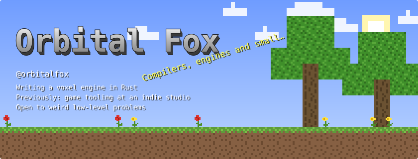

<p align="center">
  
</p>

<h1 align="center">Readme Atelier</h1>

<p align="center">
  Designed, self-updating GitHub profile READMEs.<br/>
  Six animated styles · live stats · no servers · no sign-in.
</p>

<p align="center">
  <a href="#quick-start">Quick start</a> ·
  <a href="#styles">Styles</a> ·
  <a href="#config">Config</a> ·
  <a href="#use-it-with-claude">Claude</a> ·
  <a href="#themes">Make a theme</a>
</p>

---

Readme Atelier turns your public GitHub data — stars, commits, streaks, languages, pinned repos — into a set of hand-built, animated SVG cards and a README that lays them out. A GitHub Action in **your own** profile repository rebuilds everything daily, so it never goes stale and never depends on someone else's server.

## Quick start

**Easiest:** use the generator at [monokern.design](https://www.monokern.design/). Pick a style, see your real profile live, then install it in one of three ways.

**Template (no downloads):**

1. Open [readme-atelier-template](https://github.com/monokern/readme-atelier-template) → **Use this template** → name the repository exactly like your username, Public.
2. Edit `atelier.yml` (theme, tagline, links, stack) and commit.
3. The **Readme Atelier** workflow builds your profile in about a minute.

**Existing profile repo:**

```bash
npx -y github:monokern/readme-atelier init --user <you> --theme y2k
git add . && git commit -m "add readme atelier" && git push
```

`init` writes `atelier.yml` and `.github/workflows/readme-atelier.yml`. The workflow does the rest.

**Locally:**

```bash
GITHUB_TOKEN=<read-only token> npx -y github:monokern/readme-atelier build --user <you> --theme garden --preview
```

Writes `README.md`, `atelier/*.svg` and a `preview.html`. Use `--demo` to try styles with a fictional profile and no network.

## Styles

| | |
|---|---|
| **Editorial** `minimal`<br/>Swiss-editorial type, ruled headlines, serif italics. Light + dark. |  |
| **Deep Blue** `y2k`<br/>Y2K dreamcore: ultramarine sky, star-burst sun, chrome type, rippling waterline. |  |
| **Blocky** `minecraft`<br/>A blocky sandbox world, inventory stats, ore-block activity. |  |
| **Phosphor** `terminal`<br/>CRT terminal, scanlines, glow, typed-in name, neofetch readout. |  |
| **Lofi Night** `pixel`<br/>A pixel city at night — every building is a week of your commits. |  |
| **Garden** `garden`<br/>A floating island: repos grow into trees, contributions bloom. |  |

Every style renders the same set of cards: `header`, `stats`, `languages`, `activity`, `repo-1…4`, `stack`, `footer` and one badge per link.

## Config

`atelier.yml` in the root of your profile repository:

```yaml
username: you              # optional in the Action — defaults to the repo owner
theme: y2k                 # minimal | y2k | minecraft | terminal | pixel | garden
name: Your Name            # defaults to your GitHub name
tagline: Building small, fast things
about:                     # up to 4 short lines
  - Writing a voxel engine in Rust
  - Open to weird low-level problems
stack: [rust, typescript, neovim, linux]   # simpleicons.org slugs or names
socials:
  x: yourhandle
  github: you
  website: example.com
  linkedin: handle
  telegram: handle
  bluesky: you.bsky.social
  email: you@example.com
repos: [project-a, project-b]   # featured repos; default: pinned, then most-starred
sections: [header, socials, stats, activity, repos, stack, footer]
accent: '#ff5fc8'                # optional accent override
```

### Action inputs

```yaml
- uses: monokern/readme-atelier@v1
  with:
    config: atelier.yml          # default
    token: ${{ secrets.ATELIER_TOKEN }}   # optional PAT to include private contribution counts
    commit: 'true'               # default
```

The workflow needs `permissions: contents: write`.

### Your README stays yours

The generated block lives between `<!-- readme-atelier:start -->` and `<!-- readme-atelier:end -->`. Anything outside those markers is preserved. If the README has no markers the first time, it is backed up to `atelier/README.backup.md`.

## Use it with Claude

The repository is agent-friendly: [`AGENTS.md`](./AGENTS.md) explains the workflow and [`skills/readme-atelier/SKILL.md`](./skills/readme-atelier/SKILL.md) is a Claude Code skill. Install it as a plugin:

```
/plugin marketplace add monokern/readme-atelier
/plugin install readme-atelier@readme-atelier
```

Then: *“make my GitHub profile in the Garden style”*. Claude reads your repositories, drafts the tagline and about lines, runs the generator, shows you the preview and pushes only after you approve.

## How it works

- **Data** — GitHub GraphQL with the workflow's own `GITHUB_TOKEN` (public data only).
- **Cards** — each theme is one TypeScript file that turns a `Profile` into SVG strings. Animations are CSS inside the SVG, so they play on GitHub and stop for viewers with *reduce motion* on.
- **Fonts** — open-licensed fonts (SIL OFL 1.1) are embedded as WOFF2, subset per card to just the glyphs it uses.
- **Icons** — [Simple Icons](https://simpleicons.org) (CC0).

## Themes

A theme implements eight renderers (`header`, `stats`, `languages`, `activity`, `repo`, `stack`, `social`, `footer`). See [CONTRIBUTING.md](./CONTRIBUTING.md) — new styles are very welcome and get featured on the website.

## License

MIT © monokern. Fonts: SIL Open Font License 1.1 — see [fonts/LICENSES.md](./fonts/LICENSES.md). Not affiliated with GitHub or Mojang; the Blocky style is an original pixel-art homage that uses no Mojang assets.
